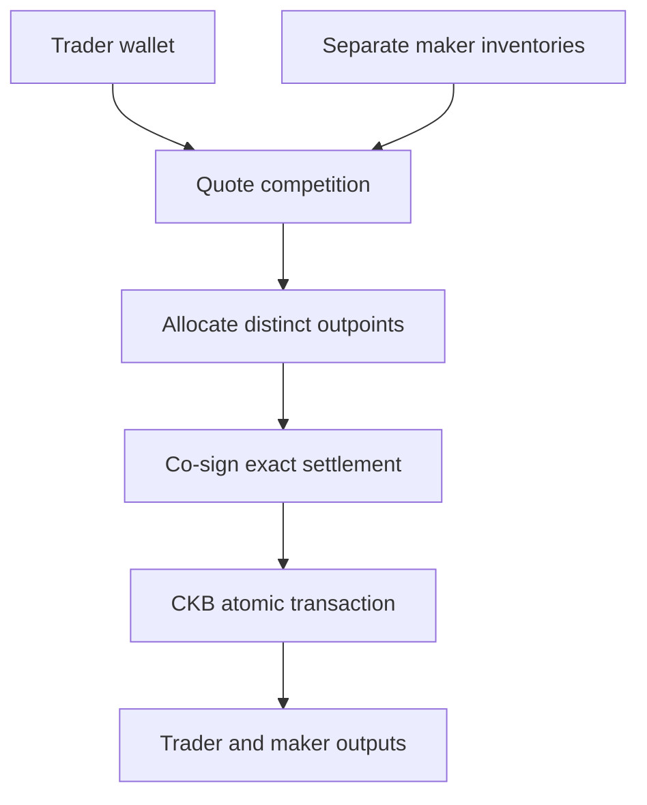
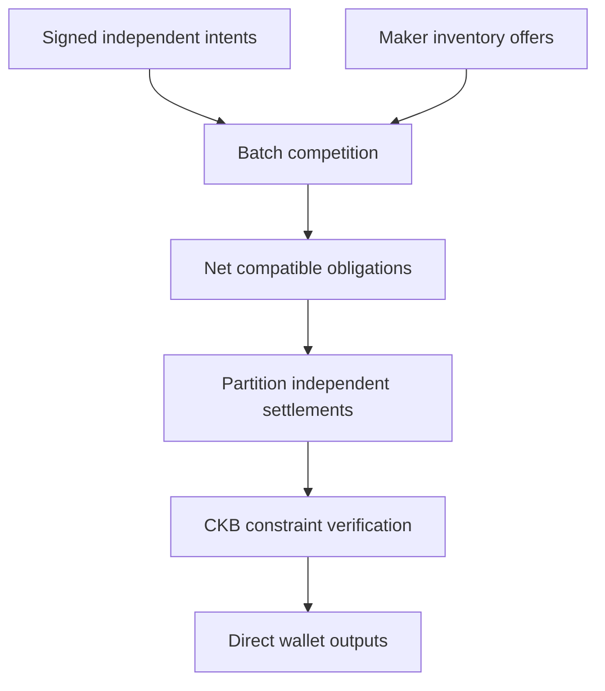
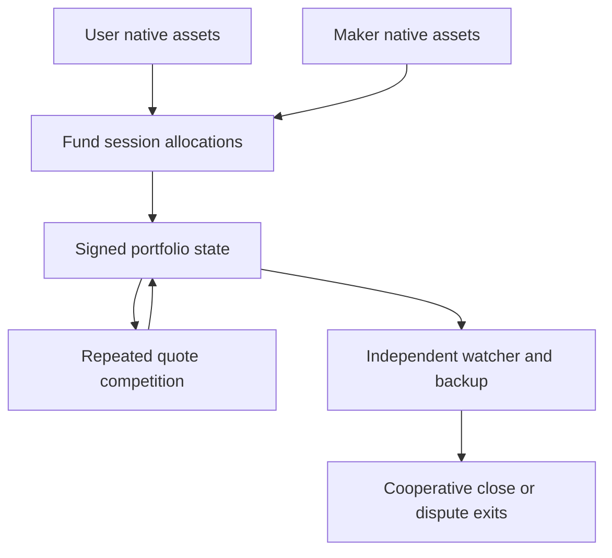
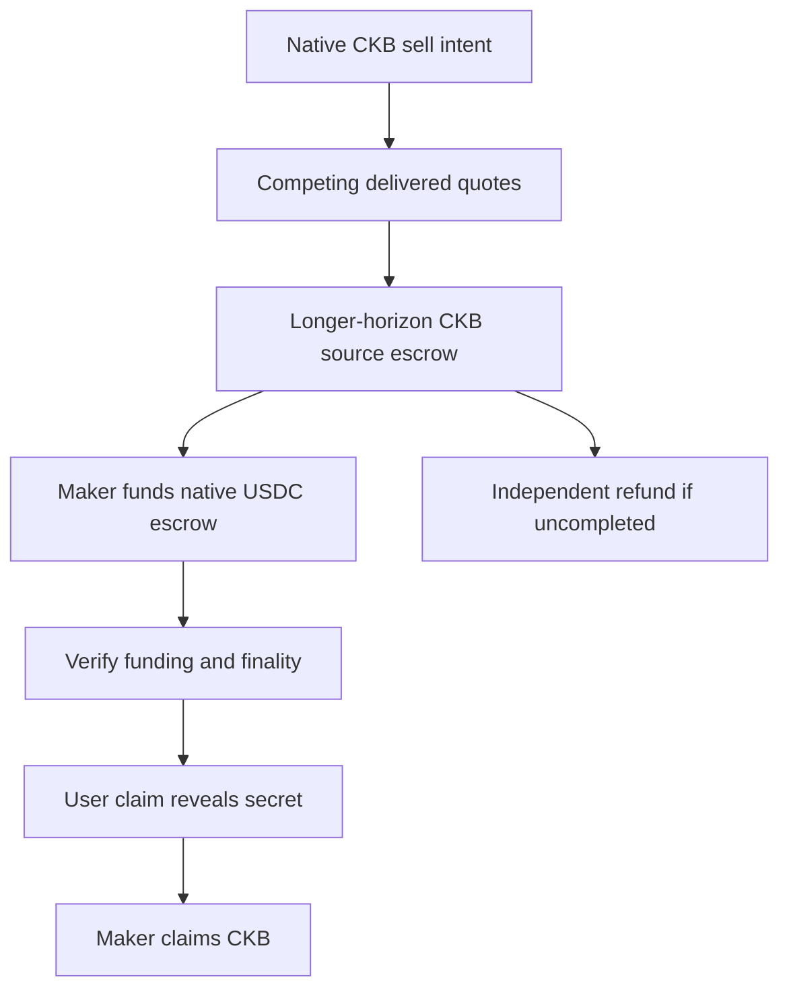
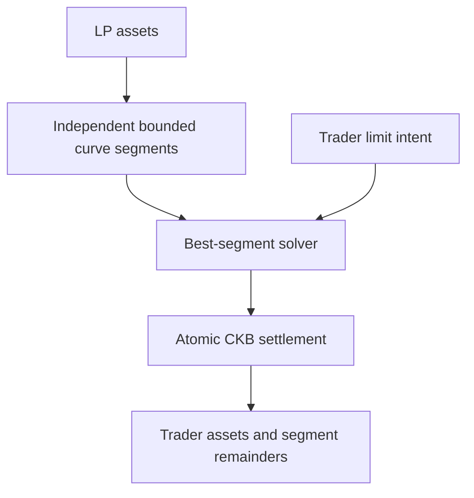
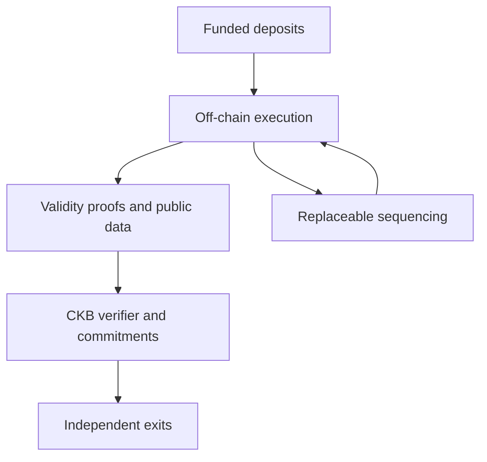

# WO01: Six competing architectures

These are candidate designs, not implemented products. Existing component claims resolve to the evidence ledger. Money amounts below are illustrative and not current quotes. Each design is evaluated at its strongest plausible form before deciding between them.

## A. Maker inventory lanes with final co-authorization

**Mechanism:** turn each maker's inventory into a graph of independent spend rights, rather than one pool. Makers advertise changeable prices; takers sign bounded requests; the winning maker signs the fully specified settlement transaction last and broadcasts it. Optional OTX is used for composable batch inputs, not as a requirement for a basic two-party atomic swap.

Journey and money: Alice offers native CKB from her wallet for an existing CKB token. Several makers return prices and the exact offered amount after fees. Alice binds her input and minimum token return. A maker reserves one of its own token cells and a separate fee budget, checks the completed transaction and signs. The transaction consumes both parties' cells and directly creates Alice's tokens and the maker's CKB, plus change and an explicit operator fee. No exchange account or global pool is involved.

Speed comes from off-chain competition, pre-indexed inventory and pre-built transactions. Price is the best authorized delivered quote. Makers can update indicative prices freely until final authorization. One logical balance can span many cells. Five sequential fills may use a chain within a lane, but a root failure invalidates descendants. Twenty lanes can be isolated from one another if they share no mutable fee/capacity/authorization inputs.

Exit: before any signature the user retains ordinary wallet control. After signing, retain and broadcast the full settlement transaction; a cancellation spend competes until committed. Independent recovery is rebroadcast/reconciliation, not a guarantee of the selected trade. A maker or taker with another valid spend can break the match. A fully funded order lock could remove some double-spend freedom, at the cost of preprocessing and slower cancellation.

Existing: CKB atomic transactions, wallet signing, OTX models, independent order designs. New: allocator with conflict graph, quote-to-transaction binding, multi-node broadcast, durable recovery tooling and realistic contract performance tests. Bottleneck moves to inventory partitioning, client signing, dependencies, signatures and chain inclusion. Revenue is explicit routing/service fees; makers earn spread after costs.

Why choose it: straightforward self-custodial swaps of useful CKB-native assets. Why not: without a sufficiently desirable native quote asset it solves only a smaller market. Independent order cells and RFQ already appear in Lucent's published direction. The lane allocator is necessary engineering, not a defensible business on its own.

Assessment: a credible fallback execution primitive, **INSUFFICIENT ADVANTAGE as a standalone business on present evidence**.

## B. Competitive batch clearing without a pool price curve

**Mechanism:** customers sign bounded asset-delivery intents. Solvers compete to satisfy a short batch through opposing orders, maker inventory and permitted external sourcing. Settlement is one or more independent CKB atomic transactions. The verifier checks signed constraints, conservation, fee ceilings and an injective assignment of outputs to obligations. No global mutable pool balance is required.

Money: in a compatible CKB/xUDT batch, 60 customers buy $100-equivalent CKB and 40 sell the same value. Their opposite transfers can cross; the solver supplies the $2,000-equivalent residual, plus capacity/fees. The $10,000 gross is not $10,000 of new solver capital. Each customer receives its own enforceable output. A fee is taken only as authorized. USD is a comparison numeraire here; this example does not establish a deployed stablecoin reserve.

Prices are clearing prices constrained by limits and competing proposals. Compare each proposed batch against the best executable individual route to avoid sacrificing one customer to improve another. A public proof of optimality over hidden off-chain orders is unavailable: the contract cannot know an omitted maker or order. Audit the admitted-order set and quote comparisons; describe best execution as a monitored policy, not a theorem.

Batching challenges AMM design by pricing from current orders rather than a balance invariant, and challenges continuous order books by replacing serial priority with a bounded competition. Existing CoW and CoBuild work already establish much of the concept. CKB-specific value would have to come from lower conflict cost and useful native asset settlement, demonstrated rather than asserted.

Fast reception is independent of settlement. A batch wait adds latency. Invalid input or withheld signature can spoil a large batch; repair by pre-validating inputs, maker-last authorization, limiting batch size and partitioning by conflict graph. True atomicity holds per final transaction, not across separate partitions. Do not announce the whole batch committed when only one partition landed.

Exit is ordinary-wallet cancellation or independent submission of a fully authorized transaction. OTX signed limits remain executable until truly invalidated. Partial-fill remainder cells must carry remaining budget and a unique identity; a generic mutable global fill counter would recreate the bottleneck. One user signing several orders over one input has mutually exclusive options, not additive funded depth.

Existing: CKB atomic settlement, CoBuild research/reference code and mature solver-market ideas on other chains. New: safe settlement validator, signing support, auction operation, output accounting and adversarial solver competition. Revenue is routing/settlement fees with a transparent maker surplus policy. Traders benefit from opposing-flow savings; makers benefit from residual rather than gross inventory demand. The failure case is insufficient contemporaneous opposing flow, in which case there is no free netting advantage.

Assessment: **PROMISING BUT UNPROVEN** for a useful CKB-native asset market, weaker than D for the immediate stablecoin use case.

## C. Competitive portfolio-channel sessions

**Mechanism:** create funded trading sessions with makers, with signed states representing both parties' portfolio allocations. Price negotiation is off chain; an exchange changes both asset allocations in one enforceable session update. Native quote assets can remain in a corresponding contract on their own chain if a correct cross-chain state protocol is established. This is the strongest contender for genuinely rapid repeated execution without a custodial exchange ledger.

Money: Alice places $500-equivalent CKB into a session and a maker allocates 500 native USDC on the external chain. A trade changes Alice's allocation from CKB to USDC while the maker receives the opposite allocation. Repeated reversals change allocations without an L1 transaction per trade. A final close pays native CKB and USDC out on their respective chains. The capacity is real funded principal, not a balance invented by the matching server.

Pricing is competitive indicative discovery followed by a jointly authorized state. Fast execution requires both signatures, correct transition semantics, retained state and a provable unilateral recovery path. A WebSocket balance update is not enough. An already enforceable state can be economically stronger than an unconfirmed L1 transaction, but has funding finality, data availability, dispute and monitoring assumptions. We have not measured those signatures or proved the cross-chain variant.

Makers need multiple bounded sessions or virtual-channel allocations. Competition across makers is constrained by where capital is already allocated. Virtual channels can reduce repeated base-layer funding, but cannot simultaneously allocate the same collateral to incompatible users. A common rebalance root creates a failure domain; partition hubs and disclose allocation limits. Moving to a new maker is not instant unless a safe funded reallocation protocol exists.

Critical attack: if two independent channel balances are updated, a counterparty might use the favorable new state on one chain and an older favorable state on the other. A common version number does not automatically stop that. Even signing a common portfolio message needs careful treatment of withheld final signatures, dispute start detection, late state revelation and independent adjudicators. A protocol must prove that unilateral exits yield one consistent outcome or an explicitly safe equivalent through all message orderings. WO01 does not claim Perun is broken; it has not established which audited protocol/implementation supplies this guarantee for the proposed assets and chains.

Repair candidates: a verified generalized cross-chain adjudication protocol; conditional updates linked through a single secret and correctly coordinated challenge periods; or restricting the fast market to a single settlement domain and using separate native cross-chain conversion for entry/exit. The last repair is safer to reason about but stops being native CKB/native-USDC trading throughout the session.

Exit: retained latest signed state, funded adjudicators, independent watcher, sufficient fee reserves and each chain's dispute/finality rules. Recovery requires more than restoring a wallet seed. A failed coordinator must not be required to reveal the latest state or secret.

Existing: Perun CKB contracts/backend, virtual/cross-chain channel work, Fiber primitives, and an existing Perun L2Trade prototype on other chains. New: verified supported cross-chain session protocol, native stablecoin asset adapters, safe allocation/rebalancing, browser recovery and maker competition. Revenue: session/trading fees or maker service subscriptions, with funding/close costs amortized across repeat trades.

Why traders prefer it: rapid repeated trading under enforceable funded balances. Why makers prefer it: immediate inventory updates and less L1 settlement exposure per fill. Why they may refuse: setup friction, capital locked per counterparty, watcher operations, and poor maker switching. A customer making one swap may be better served by D.

Assessment: **PROMISING BUT UNPROVEN**, highest repeated-execution ceiling; its cross-chain safety and capital utilization are decisive missing evidence. Do not demote it merely because A already works at the pool level.

## D. Competitive native cross-chain delivery market, the leading business candidate

**Mechanism:** auction a fully specified native-asset delivery obligation to makers with segregated inventory. Trade-specific escrows exchange native CKB against native USDC on a supported external chain. Prices remain updateable until final authorization; maker inventory is reserved once, and each in-flight trade has independent recovery. Same-chain orders may batch where atomicity is actually available. No universal bridge balance or exchange-owned customer ledger exists.

Complete journey: Alice chooses amount, destination chain/address, minimum receipt and a maximum wait. Makers quote a net USDC delivery after fees and recovery conditions. Client chooses the best feasible quote, not just the highest indicative number. Alice signs/funds the source conditional CKB output. Maker verifies funding and its required confirmations, hedges according to a documented policy, and funds a destination escrow to Alice. Client independently checks escrow code, amount, recipient, hash and all deadlines, waits for the selected destination finality threshold, then reveals the secret through a claim. Maker claims the CKB. The operator receives only explicitly signed fees, ideally conditional on successful completion. Refunds must not silently charge the full success fee.

The reverse journey is not assumed symmetric in implementation. Alice funds native USDC source escrow, maker funds CKB destination escrow. Test destination CKB claim/refund races and source-chain timeout ordering separately. A forced refund may take much longer than an ordinary completion. Show that worst-case capital lock before the customer signs.

Who holds assets: before funding each wallet owner does; in flight the escrow scripts control specified amounts; after success the intended recipients do. Maker inventory stays in maker wallets outside allocated escrows. Operator has discovery and coordination authority, no permission to redirect assets. USDC issuer controls remain external asset risk. CEX hedge inventory introduces maker counterparty exposure; it is not customer escrow custody.

Price: competitive all-in quotes backed by current inventory. No oracle is required for the basic swap contract. Oracle/venue prices are optional sanity checks, never payment evidence. Maker signing last limits quote staleness before commitment. After source funding a fixed-price cross-chain trade still creates a lockup/abort option: the party controlling the secret may abandon rather than complete. This is priced risk, not solved by the auction.

Capital: independent escrow tranches partition 100 simultaneous trades if both sides have the usable inventory. Rebalance only residual flow when safely possible. An operator cannot net unrelated customer secrets into one global promise. A missed maker can be replaced for an uncommitted quote; an already allocated escrow may require its original route or refund, unless an audited reassignment branch exists.

Speed: receipt, quotes and transaction preparation can be responsive. Actual completion requires chain funding/finality/claims and is not CEX execution. Native delivery is the product's proposed benefit. Instant spending of an unconfirmed payout would require separate funded credit or channels and must be sold as such.

Existing: standard cross-chain escrow designs, CKB script programmability, transaction composition, makers' external inventory and existing wallet distribution. 1inch Fusion+ is a strong architectural rival, not a template whose novelty we can claim. New: CKB escrow and tests, external-chain adapter, secret/recovery client, inventory lane allocator, solver protocol and monitoring. Solana support is an adapter project with its own contract and finality verification, not a configuration flag.

Why a Binance customer might use it: CKB starts in their own wallet and the stablecoin arrives in their chosen wallet without an exchange deposit, manual trading/withdrawal sequence or wrapped CKB. Why makers might use it: monetize existing two-chain inventory and residual imbalances. Why holders might supply assets: only through an explicit risk-priced maker mandate, not a guaranteed passive yield product.

Revenue: transparent success-based routing fee and potentially wallet integration/service revenue. Defensibility: distribution, better executable coverage, measured reliability, maker relationships and independent recovery quality. The protocol alone is easy for an established wallet or aggregator to replicate.

Assessment: **PROMISING BUT UNPROVEN**, selected because it directly serves a useful asset-conversion job while avoiding a mandatory native-stablecoin pool. It does not yet meet the complete CEX-like mission.

## E. Parallel bounded curve ribbons

**Mechanism:** passive liquidity is divided into independent fixed-budget curve segments. Each segment has its own asset amounts and price schedule, rather than one global invariant. A solver selects or batches the best compatible segments. A maker may offer an actively reauthorized ribbon; a passive ribbon cannot assume instant off-chain cancellation.

Money: an LP allocates CKB and a CKB-native token among twenty segments, each authorizing only a limited amount at specified prices. A taker pays token and receives CKB from selected segments. Fees return to the LP or a separate claimable output, not a shared fee accumulator. The LP can withdraw unspent segments under their owner path, but pending fills race cancellations.

Fits CKB because each segment is an independent cell transition. It challenges AMM organization: price/depth are the sum of bounded independent offers, not one reserve ratio. An active maker can re-sign small inventory slices; passive LPs hold explicit short-option exposure. A global price oracle, liquidity share accounting cell or rebalance counter can silently restore contention. Solver aggregation cannot make fragmented inventory continuous at every size.

Exit is an owner withdrawal or a timed reclaim, with honest description of pending authorizations. Existing components are cell scripts, pricing math and OTX-style matching. New are audited segment contracts, safe remainders, selection algorithm and LP risk reporting. Bottlenecks are fragment search, signature/cycle costs, staleness and capital stranded away from current price. Operator earns route fees; LP earns fees only if they exceed adverse selection/rebalancing costs.

Assessment: **REDESIGN REQUIRED as a passive competitive CKB/stablecoin market** on current evidence. The strongest active repair converges toward A; passive curves have no identified price advantage over professional makers.

## F. Validity-proven trading rollup with independently reconstructible exits

**Mechanism:** place trading in a new execution domain. Fund segregated deposits; execute orders rapidly in an off-chain state machine; prove valid transitions to a CKB verifier; publish sufficient data for users to reconstruct balances and exit without the operator. Multiple execution shards may partition markets/accounts, with an explicit safe cross-shard transfer protocol.

Money: Alice deposits assets supported in the settlement domain. A maker deposits the other asset. Off-chain execution debits and credits allocations under a verifiable state-transition rule. Operator takes authorized trade fees. Proof acceptance and available data anchor withdrawal rights. A sequencer receipt before proof publication is a weaker promise, unless additional funded guarantees cover it. Force inclusion, escape deadlines and withholding behavior must be designed rather than presumed.

This can challenge the slow-settlement bottleneck more directly than repeated L1 fills. It requires proof-generation infrastructure, an audited CKB verifier, data availability, state reconstruction, forced exits and sequencer replacement. A shared root is acceptable only if exits remain live through sequencer failure and root-update bottlenecks are measured. Optimistic variants replace proof computation with challenges, fraud proofs and long exit assumptions.

Native USDC elsewhere does not automatically live inside the rollup. A wrapped representation adds bridge/adjudicator risk; a coordinated multi-chain withdrawal design is substantial additional protocol research. Without that, F improves repeated trading of a limited native-asset set but does not solve D's customer job. CKB verifier feasibility, proof costs, setup and witness/data capacity were not benchmarked in WO01.

Assessment: **PROMISING BUT UNPROVEN technically, INSUFFICIENT ADVANTAGE for the initial business on current evidence**. It is the deliberately ambitious new-infrastructure candidate, preserved for high-demand conditions rather than dismissed as impossible.

## Comparative decision

| Candidate | Responsive control | Strong pre-L1 execution claim | Native external stablecoins | Capital shape | Present deciding weakness |
|---|---|---|---|---|---|
| A | Plausible | No, ordinary pending transactions | No direct solution | Independent cells/change chains | Missing useful native quote demand |
| B | Plausible, plus batch wait | No, unless funded claims added | Not from CKB batching alone | Residual net inventory | Sparse opposing flow and hidden competition |
| C | Plausible after funding | Plausible with correct channel protocol | Requires proven cross-chain protocol | Session/channel allocations | Atomic unilateral cross-chain exit and lock-in |
| D | Plausible | Conditional escrow protection after funding | Yes in design | Two-sided escrow inventory | Abort option, capital occupancy and price competition |
| E | Plausible discovery | No | No direct solution | Fragmented passive segments | Toxic flow and price fragmentation |
| F | Plausible | Depends on proof/data/guarantee stage | Requires substantial extra machinery | Rollup deposits | Cost, scope and no validated demand advantage |

No row dominates every other. D is the strongest current business hypothesis. C is the most important high-ceiling rival to keep attacking. A and B are reusable execution mechanisms, not automatic products. We explicitly avoid selecting them merely because their core transaction behavior is easier to demonstrate.
