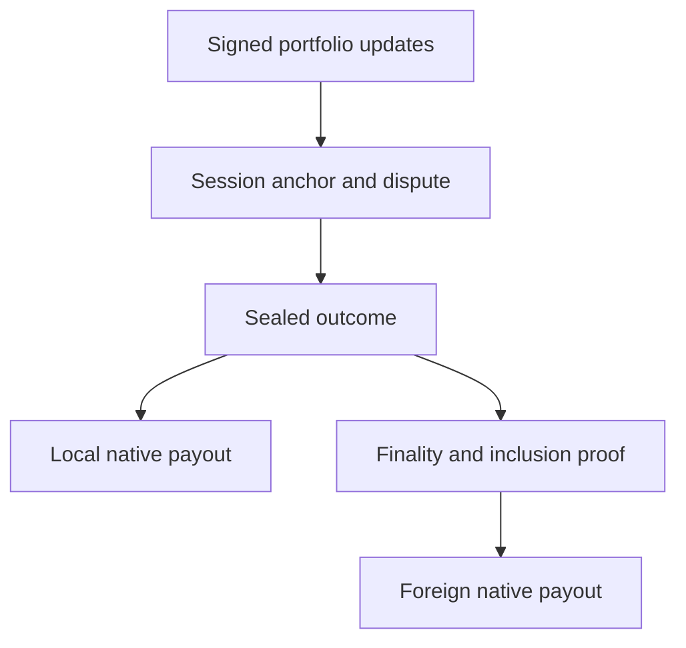

# One authoritative close outcome per funded session

**Leading candidate: funded portfolio sessions with one authoritative close outcome and proof-gated external payout. PROMISING BUT UNPROVEN.** This is a research candidate, not a claim that a bridge-free production construction now exists. The independent-adjudicator baseline requires redesign.

## Mechanism

A trader and a maker fund native assets in chain-local vaults. Each accepted off-chain update signs one complete portfolio allocation, including both chains' exact asset identities and beneficiary addresses. A session has one adjudication anchor. Its dispute protocol selects and seals one authorized state. Other vaults release only against a sound proof of that sealed state. They never independently choose a competing version.

The session anchor may be a CKB cell. Different sessions have distinct funding cells and dispute state. There is no requirement for one globally mutable pool or venue-wide root. Within a session, sequential updates are natural. Across sessions, the independent inventory-lane idea survives. Proof batching might aggregate several sealed outcomes without merging asset custody, but that is hypothetical.

The off-chain UX may be responsive once the participant retains a complete enforceable state and exit data. No sub-second finality, measured matching performance, or instant native-wallet delivery is established. A channel balance is a funded claim until exit, not a settled external wallet balance.

## Round A: strengthen

Bind the entire portfolio in every signature, check conservation on each asset, retain both signatures, allow unilateral dispute, monitor all ledgers, and restart challenge windows on new states. Share custody with no operator. This is substantially stronger than signing separate unrelated payment vouchers.

## Round B: break

A privately completed certificate can outlive an earlier leg's update window. Eagerly starting disputes on all legs improves monitoring but can leave slightly different local cutoffs. A late valid update on the later leg cannot be relayed into an earlier leg that has already stopped accepting updates. Neither a common nonce nor an acknowledgement erases the certificate.

The experiment demonstrates this for the lab protocol. It does not prove every channel protocol fails, nor establish a vulnerability in Perun, Fiber or another implementation.

## Round C: repair

Make the outcome authoritative once. A follower proves which allocation that authority sealed, rather than deciding which signed version it personally saw. This changes the consistency mechanism, not merely a timeout parameter. An honest attestor control executed consistently; a dishonest attestor executed an inconsistent payout. Therefore an attestor cannot be relabeled a trustless proof verifier.

## Round D: break the repair

A follower with no independent refund may remain locked when proof delivery fails. Adding a unilateral refund at a local deadline can contradict an anchor outcome that was validly finalized but proved late. The finite model preserves this counterexample. Unlimited proof/chain failure cannot provide both unconditional principal restoration and asynchronous irrevocable foreign payment.

A finalized proof must also mean something precise. A Merkle branch without authenticated consensus is insufficient. A short header sequence is not necessarily the canonical greatest-work CKB history. A finalized EVM receipt without verifying the relevant consensus/finality assumptions is insufficient. A succinct proof needs a correct circuit, a pinned verification key, an explicit checkpoint/upgrade policy and an available witness, not just a small proof object.

## Strongest repair worth testing

Permissionless proof generation and relay, independently retained outcome data, fee sponsorship and a sound finality/inclusion verifier could restore bounded liveness without giving an exchange operator signing control. The anchor's dispute protocol still needs native implementation, signature validation, recovery and stale-state challenge tests. If it is CKB, use actual lower-bound `since` semantics for challenge maturity, never a fictitious hard claim expiry. A final outcome cell/event must be uniquely tied to the original funded session and exact output obligations. Its serialized proof path must be tested against CKB's actual commitment structure.

A CKB anchor means foreign-chain verification of CKB consensus/outcomes. An EVM anchor means CKB verification of EVM finality/outcomes. Choosing a direction by proof cost and safety is an engineering experiment still to run. This is bridge-like verification infrastructure even if no wrapped token or bridge custodian exists.

## Price commitment and cancellation remain separate

A retained signed proposal may be exercisable by a party who later completes the signatures. A wallet saying “request timed out” does not revoke it. Maker-last signing transfers rather than eliminates the option. A production design must preserve pending proposals and specify whether they remain limit orders until superseded or a forced exit/cancellation invalidates them. Fast cancellation acknowledgement and enforceable cancellation are different stages.

A unilateral authorization-cell cancellation could bound this risk after its conflicting spend settles, but reintroduces on-chain cancellation latency. A reliable publication service or enclave can change availability assumptions, but adds trust. No safe millisecond cancellation mechanism is claimed here.

## Practical customer fit

This design targets repeated self-custodial traders who accept session funding and bounded exit. For a user who starts with CKB and wants stablecoins immediately in an external wallet, per-trade delivery can remain the better product. Keep WO02's repaired escrow fallback, competitive makers, inventory lanes and netting. Do not force every customer into channels.
