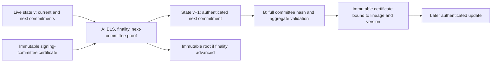

# WO04-E2B: bounded persistent Capella trust chain

**Executed:** the real seven captured updates advanced a unique CKB-enforced state lineage, with no host-selected committee replacement after the fixed bootstrap. Separate committee certification, authorized immutable root publication, restart recovery and negative authority tests ran on CKB v0.210.0 under the unchanged 70-million-cycle transaction policy.

**Not demonstrated:** a live current-fork Ethereum client, a fresh weak-subjectivity anchor, arbitrary participation, or an E1 principal payout. This is the complete bounded *historical Capella* chain requested, not production readiness.

The E2A verifier, optimization experiments and their evidence remain untouched. This directory contains new source and evidence only. Earlier E2B checkpoints/diagnostic runs are retained in Git and evidence/; the final program is the shared `bundle` implementation.

## Program identity and state

`bundle.c` dispatches three type-script roles by disjoint canonical argument lengths: 32 bytes for state, 112 for committee certification, 104 for root publication. Each role authenticates the other roles against its **own loaded code hash**, with `data2` hash type and exact argument shape. Thus a caller cannot name an arbitrary registry implementation as a trusted state. A single immutable program avoids circular state/certificate code-hash constants. `root_probe.c` is a separate laboratory consumer pinned to that bundle's actual code hash.

State identity is the full CKB script hash of `(bundle code hash, data2, Type-ID nonce)`. The state type calls the vendored `ckb_validate_type_id` implementation and independently requires the state at global input/output 0 for transitions. Creation uses exactly:

`CKB_BLAKE2B(serialized first CellInput[44] || uint64LE(global output index))`.

The 44-byte input includes `since:uint64LE`, transaction hash[32], and output index:uint32LE, with no invented wrapper. The state is created at output 0. Exact construction is checked both by CKB and independently by summarize.py; wrong output index and a second constructor using the same nonce fail. The Type-ID primitive supplies uniqueness, **not** the trust-state rules: custom checks also forbid deletion, require one continuation, preserve state capacity, validate all data changes and enforce monotonic versions/finality. Distinct independent registries can exist; only one lineage exists under a chosen identity. Applications must pin that identity. A genuine independent registry was created and its root rejected by the primary consumer.

State data is 280 bytes:

| Offset | Field |
| ---: | --- |
| 0 | `E2STATE1` magic[8] |
| 8 | Ethereum mainnet genesis validators root[32] |
| 40 | fixed trusted bootstrap beacon root[32] |
| 72 | state version:uint64LE |
| 80 | finalized beacon slot:uint64LE |
| 88 | finalized beacon header SSZ root[32] |
| 120 | finalized execution state root[32] |
| 152 | execution block number:uint64LE |
| 160 | execution block hash[32] |
| 192 | finalized committee period:uint64LE |
| 200 | current committee SSZ commitment[32] |
| 232 | next committee commitment[32], zero if unknown |
| 264 | last accepted signature slot:uint64LE |
| 272 | enforced fork version[4] and reserved policy bytes[4] |

Creation verifies the actual bootstrap header against the fixed historical checkpoint, its execution-header/body binding, and current committee proof at gindex 54. No state, certificate or finalized-root cell is injected into genesis. Genesis supplies only code cells and disposable untyped funding cells.

## Transaction A: authenticated update

The state script derives the signing committee from its actual input state's current/next commitments and period. Its first dependency must be an immutable certificate of the same program class, lineage and authorized period/root, with origin version no later than the input version. The driver can propose data and proofs; it cannot replace the authoritative committee.

The script checks real participation/missing-member proofs, canonical affine/compressed bindings, missing-key G1 subgroups, G2 signature subgroup, correct mainnet Capella signing domain, hash-to-G2 and simultaneous pairing. The aggregate subgroup check is safely reused from the exact immutable certificate. It also verifies **both** attested and finalized execution-header/body branches, finality at gindex 105, and next-committee root at gindex 55 when supplied. Full committee raw data is not blindly trusted as an update input.

Signature time is bounded through an absolute timestamp `since` on the state input: it must be at least `Ethereum genesis_time + 12 * signature_slot`, and CKB's own maturity validation checks it against CKB chain time. This is not a maximum-age/live-sync policy. Fork selection is Capella at signature_slot - 1; unsupported later-fork updates fail closed.

Every accepted update increments the version; finalized data never rolls back. This finalized-only subset requires an actual finality advance or acquisition of an unknown next committee. The latter exception is necessary for captured update 0, whose finality is older than the bootstrap. It learns next committee 863 while retaining the bootstrap finality. Merely changing a previously accepted `signature_slot` cannot create a new transition: that field is not itself BLS-signed, and a retimed replay without new finality/committee information is rejected.

When finality crosses a period, current committee becomes the **previously authenticated next** committee; the update's proven next commitment is recorded for the subsequent period. No certificate of an unrelated registry or period can participate. An update cannot advance finality while omitting its correctly bound authorized-root output.

## Transaction B: certify the committed committee

The separate certificate constructor reads a live state dependency with the same immutable program and exact state lineage. Its arguments bind lineage[32], program hash[32], origin state version[8], period[8] and committee root[32]. That root must be the current or next commitment in the actual state version. Caller-created registries using an always-success program were actually created as negative controls; they cannot mint these certificates, even if their data mimics state layout.

The witness contains all 512 compressed member keys, the compressed aggregate and canonical affine aggregate (24,720 bytes). CKB hashes the full key vector and aggregate into the exact authenticated committee SSZ commitment. It validates the aggregate's canonical encoding, compressed correspondence, curve and G1 subgroup, then stores a 296-byte certificate with the source identity/version/period/root, key-vector root and aggregate encodings. The constructor does **not** claim to subgroup-check all 512 individual keys: canonical committee semantics come from the authenticated Ethereum state; updates still explicitly validate each missing key. No unproved aggregate or arbitrary caller hash becomes authoritative.

The certificate type forbids every later input/spend, so its validated point cannot change. It can be reused across updates while its period/root still match the current state's authorized commitments. Updates 5 and 6 actually reuse the same certificate for period 867.



A already completes the current update's finality predicate. B only makes an authenticated committee usable for subsequent updates. Failed/abandoned B cannot publish a finalized root or authorize the next period without a certificate; it does not invalidate A's already verified current outcome. B is not an incomplete BLS proof being treated as atomic with A. The tests restart CKB after committed update 0, reload version 1 from persisted cells, reject uncertified advancement, then recover B and finish the chain. Wrong/stale certification, failed updates, conflicting state copies and replay were rejected.

## Authorized immutable roots and E1

The root role requires the **same transaction** to consume and reproduce the exact state identity with version +1 and advanced finality. Its arguments bind state lineage, program class, source version and finalized beacon root. It accepts no substitute registry implementation. Every finality-advancing state transition also requires this exact root at output 1. A failed state proof fails the entire transaction, so no root survives a failed update.

Root data preserves E1's exact 104-byte layout:

`SHA256(genesis_validators_root || state_script_hash)[32] || execution_state_root[32] || block_number_LE[8] || block_hash[32]`.

The typed root is immutable. The laboratory consumer verifies bundle code identity, canonical root role/lineage, source version, current live state, finality/root values and domain before optionally invoking the unchanged E1 `prove()` implementation against bytes 32–63. It rejects an independently valid foreign registry, stale root/version, spent state and a root published without a transition. The actual saved Ganache E1 account/storage proof fails under the authenticated Ethereum root (MPT error 30).

The probe is **not** an E1 principal settlement contract: its metadata-only mode tests authority, and no matching positive E1 storage proof or principal payout is claimed. Original E1 contracts are unchanged. Real integration must bind the intended registry/root identity and trade domain in the reservation/settlement flow, and use an Outcome deployment and account/storage proof from the *same authenticated Ethereum history*. The old Ganache proof cannot be relabeled or reused.

## Actual executed costs

All numbers below include every script in the tested transaction, including the ordinary input lock and the root type when present. CKB policy remained 70,000,000 cycles; the driver asserts it before startup. Output policy was `passthrough` for custom lab scripts, retaining script/transaction verification. The development block limits and dummy mining are not public-chain admission evidence.

| Update | Participation | Version | Finalized slot | Period | Cycles | Tx bytes | Root |
| ---: | ---: | ---: | ---: | ---: | ---: | ---: | --- |
| 0 | 511 | 1 | 7069376 | 862 | 63,177,960 | 3,614 | no: committee learning only |
| 1 | 512 | 2 | 7070047 | 863 | 60,792,733 | 3,530 | yes |
| 2 | 511 | 3 | 7078240 | 864 | 63,372,308 | 3,964 | yes |
| 3 | 510 | 4 | 7089280 | 865 | 65,863,876 | 4,398 | yes |
| 4 | 512 | 5 | 7094272 | 866 | 60,792,733 | 3,530 | yes |
| 5 | 512 | 6 | 7104096 | 867 | 60,792,733 | 3,530 | yes |
| 6 | 512 | 7 | 7109344 | 867 | 60,719,806 | 3,530 | yes |

Bootstrap: 530,165 cycles / 1,649 bytes. Initial committee certification: 17,424,353 cycles / 25,590 bytes; subsequent certification: 17,424,361 cycles / 25,590 bytes. The authority/MPT probe's positive metadata case cost 27,609 cycles / 321 bytes. Machine-readable summaries and raw transactions are authoritative if checking exact counters.

The smallest measured headroom is **4,136,124 cycles**. The shared bundle is **148,016 bytes** and is deployed once for all three roles; the separate diagnostic probe is 8,888 bytes. Hashes are recorded in binaries-final.json and the verified reproduction metrics.

Every tested state, certificate and root was allocated 1,000 CKB from disposable genesis funds. Derived occupied-capacity minima under these exact lock/type/args/data shapes are 386 CKB for state, 482 for certificate, 282 for root, and 148,057 CKB for the shared code cell. Primary retained protocol data cells total 14,000 allocated CKB (one state, seven certificates, six roots), excluding code and test controls. The test fee is 1,000,000 shannons per transaction, not a market-fee or profitability estimate. Code was loaded through genesis; a real deployment transaction/fee was not benchmarked. Immutable records currently have no reclamation path.

## Negative evidence and scope

The final run has 23 committed transactions: 15 for the primary chain, five for an independent valid registry, one malicious-registry control, and two authority-probe transactions. It records 104 real node rejections, checked to be script/context failures rather than connection errors. Cases cover wrong Type-ID nonce/index, duplicate state, deletion, exact and retimed replay, wrong signing period, unbound time, coherent rollback proposals, failed update/recovery, invalid next proof, unavailable/wrong/stale certificates, registry substitution, immutable record mutation, forbidden later fork, root withholding, unauthorized publication and wrong-history E1 proof. Full result, including actual serialized transactions: evidence/chain-recovery.json and the verified reproduction run.

The final execution root is `0x226f5ff47ab3725b5a4a3afc74b1e79e4aa3a29704561eccce590e58900baec3`, at finalized beacon slot 7109344, state version 7. It is historical Ethereum mainnet Capella finality **under the pinned checkpoint assumption**, not a statement of current Ethereum state.

## Fork correctness and remaining work

Official consensus specs are pinned at v1.6.1 (`5fa6edcca8ab4cf548653e6680b17b9d3e04d225`); the existing Capella captures retain their prior provenance. Configuration/reference tests verify:

- Capella/Deneb gindices 54, 55, 105, 25; Electra/Fulu 86, 87, 169, 25, with the corresponding changed branch depths.
- Mainnet fork versions 03/04/05/06, epochs 194048/269568/364032/411392 and signature_slot - 1 domain boundaries.
- An official Electra random SSZ LightClientHeader fixture reproduces its independent expected root `bd766b20a4ea322c1f3ec9fe25895cf115c117d6665fbba47b35e7fb097a57b7` using the 17-field execution header. The Capella 15-field interpretation and mutated blob gas fail.
- Official Electra current/next/finality proofs derive a consistent state root; legacy indices/depths fail.

These are actual **SSZ/config/reference tests**, not later-fork BLS-finality tests. The random SSZ header is a structural vector, not fabricated canonical chain evidence. The CKB runtime deliberately rejects Deneb and later updates. Modern header validation, fork transitions, larger branch structures, relevant consensus rules and genuine newer-fork signed vectors must be executed before enabling them. Changing indices alone is insufficient.

The runtime supports at most two absent members and is a strict finalized-only subset with a next-committee-learning exception. Wider participation/update classes and timeout/force-update behavior are not implemented. The authority probe conservatively accepts only its current state version; general historical-root retention/freshness policy is not production-ready.

The historical checkpoint was recovered from the pinned upstream test, not independently acquired as a fresh weak-subjectivity anchor. Current deployment needs a recent trusted checkpoint independently justified for the correct chain, complete modern-fork synchronization, checkpoint-age/update-freshness policy, CKB confirmation/reorg policy, production review and genuine E1 proof/payout integration. CKB-chain reorgs are not prevented by application scripts. No public deployment or real assets were used.

## Reproduce without overwriting a milestone

Use the existing pinned E2 dependencies (Python 3.12, py-ecc 8.0.0, Zig 0.14.1, blst 0.3.15, Node 24 with locked E1 SDK/ethers, verified CKB 0.210.0). No new package or live Ethereum endpoint is needed. See the parent README/cloud setup report if ignored dependencies are missing.

```sh
cd labs/wo04-e2/rotation
bash src/reproduce.sh
```

The script generates a new timestamped evidence label, verifies captured/derived fixture hashes, rechecks all seven real reference signatures, compiles the program, runs the actual CKB chain/restart/negative cases and later-fork references, then independently audits Type-ID serialization and committee-certificate ancestry. Set a **new** `E2B_RUN_NAME` explicitly when desired. Existing milestone files are retained. Ports 19224/19225 must be free; the script starts/stops only its own loopback node and may need the cloud executor's approved local-process permissions. No worktree, public RPC, public deployment or secrets are required.
